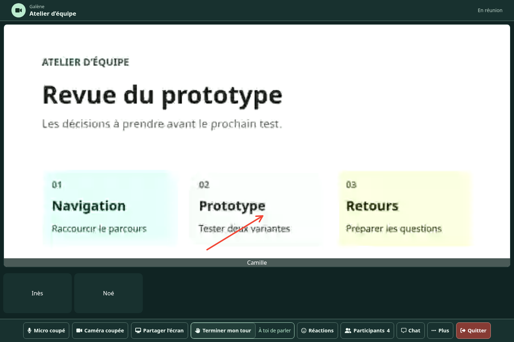
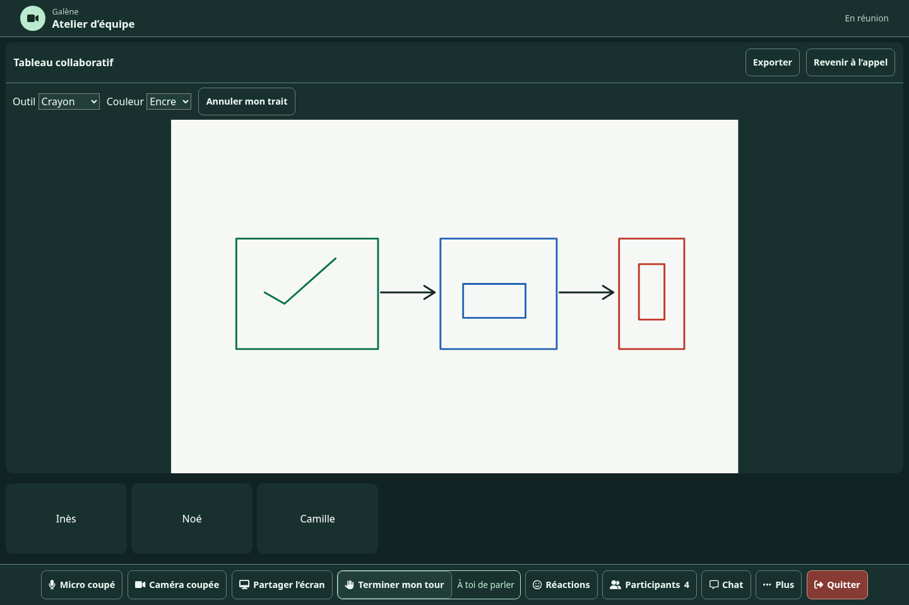
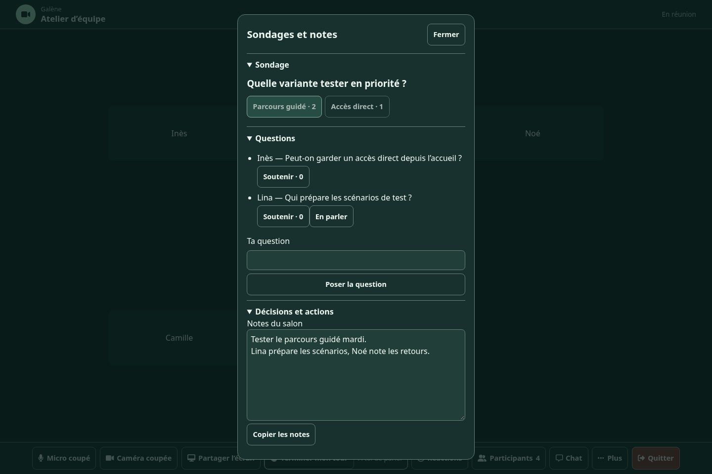
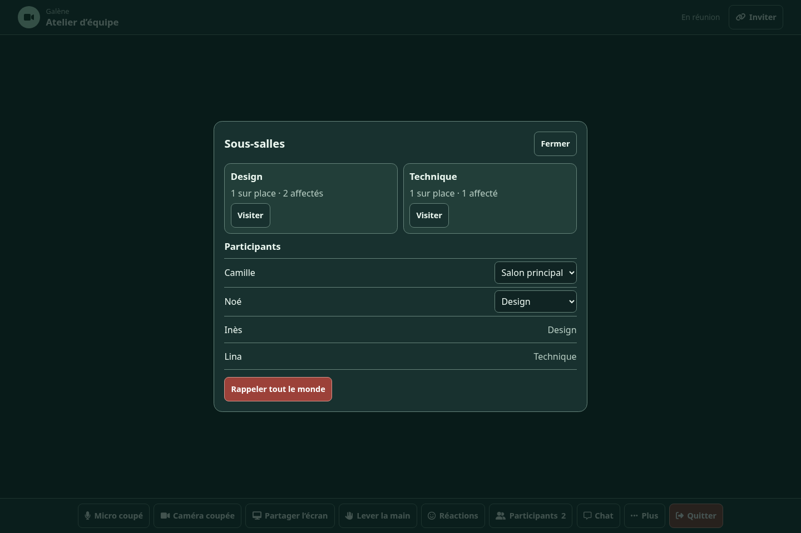
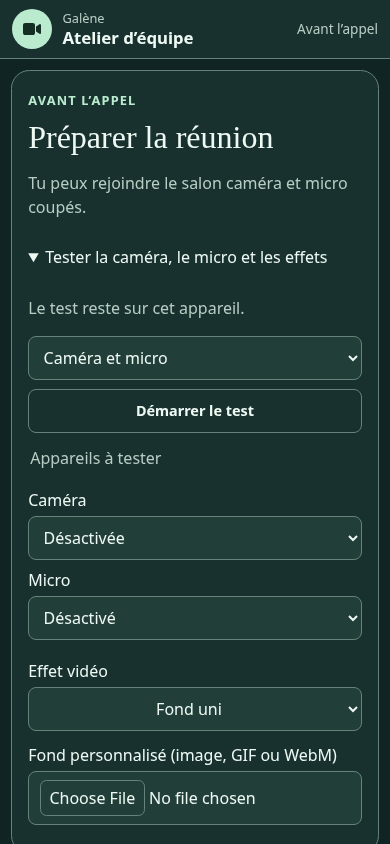

# The Galene videoconferencing system

Galene is a fully-featured videoconferencing system that is easy to deploy
and requires very moderate server resources.  It is described at
<https://galene.org>.

## Additions in this fork

[Galène is the upstream project](https://github.com/jech/galene), written by
Juliusz Chroboczek and its contributors. The additions below build on Galène's
server, media stack, and web client.

| Area | Additions |
| --- | --- |
| Room interface | French call controls, a mobile layout, invitation links with expiration controls, and tiles for participants without a camera |
| Camera and preview | Camera and microphone testing before joining, stronger default background blur, a solid background, and image, animated GIF and WebM backgrounds. A softer, more stable person mask and a concealed image if filtering fails |
| Participation | An ordered raised-hand queue with a personal position indicator, floating emoji reactions, a firework animation when reactions arrive together, and sound notifications for arrivals and raised hands |
| Presentation | Automatic focus on a screen share, a participant filmstrip, a shared pointer, and temporary annotations with presenter-controlled access |
| Meeting tools | A shared whiteboard in the main view with SVG export, an optional Excalidraw link, polls, supported questions that can be attached to raised hands, and shared decision notes |
| Access and groups | A waiting room with moderator admission or admission by an existing participant, and temporary breakout rooms with manual or balanced assignments, live occupancy, and a collective return |
| Connection and captions | An audio-first receive mode with an option to keep screen shares, WebRTC connection diagnostics, and optional [French captions](contrib/galene-stt/README.md) |
| Meeting portal | Join by room name, invitation URL, or a link carrying a token; see public room attendance and participant names before joining; and create a permanent room protected by a guest password or open to the public |
| Companion mode | Join from a second device with its microphone and incoming audio initially muted, with an option to enable audio and use the camera |

To use companion mode, open the same room on the second device and select
**Rejoindre en mode compagnon** before joining. The second device appears as a
separate participant. Its sound can be enabled from the call controls.

When creating a room, **Faire patienter les invités** enables admission by a
participant already in the room. The first participant can enter directly.
Names shown before joining are available for public rooms.

### Screenshots

**Presentation and collaboration**





**Participation and moderation**






**Joining and room access**


**On mobile**

 

## Quick start

These instructions install the `room-tools` branch. You need Git and Go; see
[`go.mod`](go.mod) for the required Go version. Run the commands as the user
that will run Galène. Keep the checkout, `data/`, and `groups/` on persistent
storage and back them up, including `data/var/tokens.jsonl` when using invitations.

```sh
git clone --branch room-tools https://github.com/mathiasbourgoin/galene.git
cd galene
CGO_ENABLED=0 go build -o galene .
CGO_ENABLED=0 go build -o galenectl ./galenectl
mkdir -p data groups
chmod 700 data groups
```

Start the server from this directory with `./galene`. By default it listens
on HTTPS port 8443 and generates a self-signed certificate when necessary.
Open `https://your-server:8443/` for the meeting portal. For a public
installation use a valid certificate and configure the firewall, WebRTC UDP
ports, and TURN as described in [the upstream installation guide][1]. Browsers
require a secure context for camera and microphone access.

### Enable room creation from the portal

The portal uses Galène's administrative API to create permanent rooms. Set up
an administrator and enable writable groups before using the create form:

```sh
./galenectl -admin-username admin initial-setup
mv config.json data/config.json
```

The command prompts for a password and creates a local `galenectl` client
configuration containing the administrator credentials. Keep it private.
The generated `data/config.json` enables `"writableGroups": true` and contains
the administrator in its `users` entry. The server user must be able to read `data/config.json` and
write to `groups/`. If configuration already exists, update it instead of
replacing it; [the configuration reference][2] describes its fields. The
server reloads configuration changes without a restart.

In the portal, open **Autorisation de création** and enter the administrator
username and password. Choose a public room or a room with a guest password.
For member admission, select **Faire patienter les invités**: the first
participant enters directly and a person already present can admit later
arrivals. Public room names are visible before joining; private room
participant names are not exposed on the unauthenticated status endpoint.

### Background effects and reverse proxy

Background blur and replacement need the optional MediaPipe files and model.
Follow [the upstream MediaPipe installation steps](galene-install.md#optional-install-libraries-for-background-blur)
on the machine serving `static/`. Without them, those effects are unavailable.
Animated backgrounds additionally depend on the browser's media support.

For a reverse proxy, configure HTTPS and WebSocket forwarding and set
`proxyURL` in `data/config.json` to the externally visible URL; see [the
upstream reverse proxy instructions](galene-install.md#running-behind-a-reverse-proxy). The
assets and WebSocket paths in this fork assume deployment at the origin root.
Serving it under a URL prefix requires corresponding proxy and asset path
configuration; setting `proxyURL` alone does not rewrite those paths.
Optional French captions require the separate [caption worker setup](contrib/galene-stt/README.md).

## Documentation

  * [galene-install.md][1]: full installation instructions
  * [galene.md][2]: usage and administration;
  * [galene-client.md][3]: writing clients;
  * [galene-protocol.md][4]: the client protocol;
  * [galene-api.md][5]: Galene's administrative API.
  
## Contributing

In order to contribute to Galene, you may:

  * send patches to [the Galene mailing list][6] by sending mail to
    <galene@lists.galene.org>;
  * submit pull requests on GitHub.

For general discussion, please use the [Galene mailing list][6] (feel free
to send mail without subscribing).  Please do not use Github for general
discussion.

## Further information

Galène's web page is at <https://galene.org>.

Answers to common questions and issues are at <https://galene.org/faq.html>.


-- Juliusz Chroboczek <https://www.irif.fr/~jch/>

[1]: <galene-install.md>
[2]: <galene.md>
[3]: <galene-client.md>
[4]: <galene-protocol.md>
[5]: <galene-api.md>
[6]: <https://lists.galene.org/>
