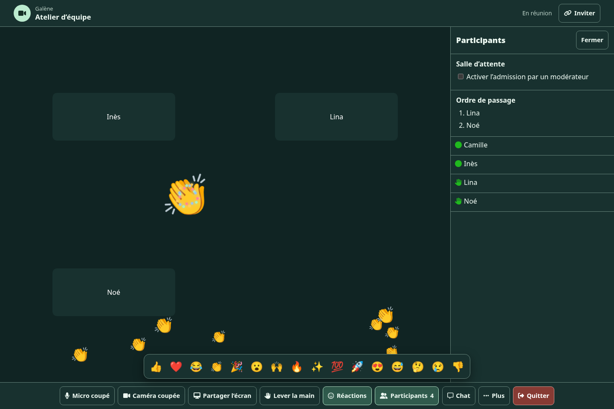
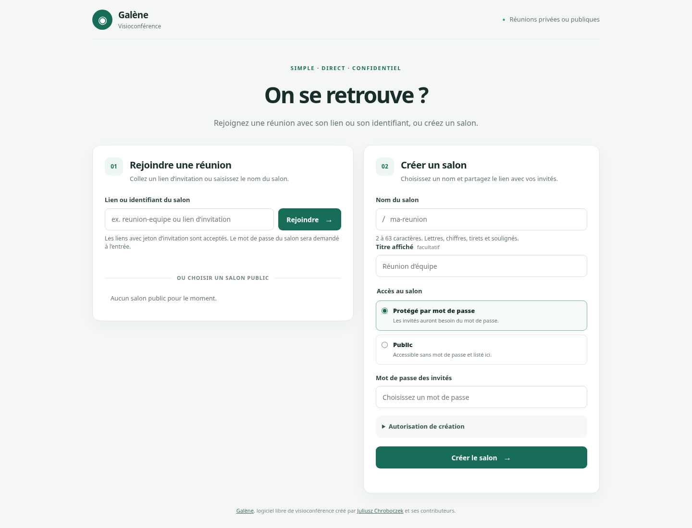
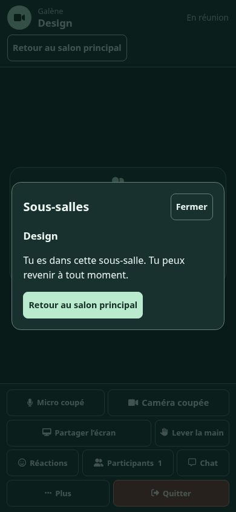

# The Galene videoconferencing system

Galene is a fully-featured videoconferencing system that is easy to deploy
and requires very moderate server resources.  It is described at
<https://galene.org>.

## Additions in this fork

[Galène is the upstream project](https://github.com/jech/galene), written by
Juliusz Chroboczek and its contributors. The additions below build on Galène's
server, media stack, and web client.

| Area | Additions |
| --- | --- |
| Room interface | French call controls, a mobile layout, invitation links with expiration controls, and tiles for participants without a camera |
| Camera and preview | Camera and microphone testing before joining, stronger default background blur, a solid background, and image, animated GIF and WebM backgrounds. A softer, more stable person mask and a concealed image if filtering fails |
| Participation | An ordered raised-hand queue with a personal position indicator, floating emoji reactions, a firework animation when reactions arrive together, and sound notifications for arrivals and raised hands |
| Presentation | Automatic focus on a screen share, a participant filmstrip, a shared pointer, and temporary annotations with presenter-controlled access |
| Meeting tools | A shared whiteboard in the main view with SVG export, an optional Excalidraw link, polls, supported questions that can be attached to raised hands, and shared decision notes |
| Access and groups | A waiting room with moderator admission or admission by an existing participant, and temporary breakout rooms with manual or balanced assignments, live occupancy, and a collective return |
| Connection and captions | An audio-first receive mode with an option to keep screen shares, WebRTC connection diagnostics, and optional [French captions](contrib/galene-stt/README.md) |
| Meeting portal | Join by room name, invitation URL, or a link carrying a token; see public room attendance and participant names before joining; and create a permanent room protected by a guest password or open to the public |
| Companion mode | Join from a second device with its microphone and incoming audio initially muted, with an option to enable audio and use the camera |

To use companion mode, open the same room on the second device and select
**Rejoindre en mode compagnon** before joining. The second device appears as a
separate participant. Its sound can be enabled from the call controls.

When creating a room, **Faire patienter les invités** enables admission by a
participant already in the room. The first participant can enter directly.
Names shown before joining are available for public rooms.

### Screenshots

**Presentation and collaboration**


**Participation and moderation**




**Joining and room access**



**On mobile**

 

## Quick start

```sh
git clone https://github.com/jech/galene
cd galene
CGO_ENABLED=0 go build -ldflags='-s -w'
mkdir groups
echo '{"users": {"vimes": {"password":"sybil", "permissions":"op"}}}' > groups/night-watch.json
./galene &
```

Point your browser at <https://localhost:8443/group/night-watch/>, ignore
the unknown certificate warning, and log in with username *vimes* and
password *sybil*.

For full installation instructions, please see the file [galene-install.md][1]
in this directory.

## Documentation

  * [galene-install.md][1]: full installation instructions
  * [galene.md][2]: usage and administration;
  * [galene-client.md][3]: writing clients;
  * [galene-protocol.md][4]: the client protocol;
  * [galene-api.md][5]: Galene's administrative API.
  
## Contributing

In order to contribute to Galene, you may:

  * send patches to [the Galene mailing list][6] by sending mail to
    <galene@lists.galene.org>;
  * submit pull requests on GitHub.

For general discussion, please use the [Galene mailing list][6] (feel free
to send mail without subscribing).  Please do not use Github for general
discussion.

## Further information

Galène's web page is at <https://galene.org>.

Answers to common questions and issues are at <https://galene.org/faq.html>.


-- Juliusz Chroboczek <https://www.irif.fr/~jch/>

[1]: <galene-install.md>
[2]: <galene.md>
[3]: <galene-client.md>
[4]: <galene-protocol.md>
[5]: <galene-api.md>
[6]: <https://lists.galene.org/>
